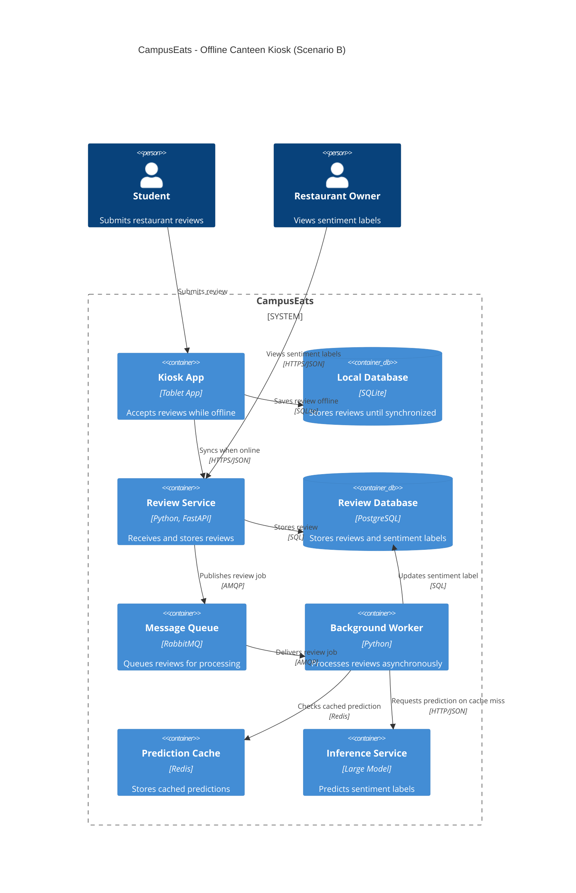

# Task 4: Deployment topologies and trade-offs

**Name / ชื่อ:** มณฑกาญจน์ นาเพาะผล

**Student ID / รหัสนิสิต:** 6870217321

This is **individual work**: each student completes and submits their own copy, in their own fork.

_งานนี้เป็น**งานเดี่ยว** นิสิตแต่ละคนทำและส่งงานของตัวเอง ใน fork ของตัวเอง_

**Scenario (A, B or C) / Scenario ที่เลือก:** Scenario B

Choose **one** scenario below. If the last digit of your student ID is odd, take A or B; if it is even, take B or C. Use your measurements from Tutorial 6 as evidence: cite run names from `results/runs.csv`. Answer in Thai or English.

เลือก scenario **หนึ่ง** ข้อด้านล่าง ถ้าเลขตัวสุดท้ายของรหัสนิสิตเป็นเลขคี่ ให้เลือก A หรือ B ถ้าเป็นเลขคู่ ให้เลือก B หรือ C ใช้ผลการวัดจาก tutorial ที่ทำไปเป็นข้อมูลอ้างอิง โดยอ้างชื่อ run จาก `results/runs.csv` จะตอบเป็นภาษาไทยหรือภาษาอังกฤษก็ได้

Facts that hold in every scenario / ข้อเท็จจริงที่ใช้กับทุก scenario:

- The large model serves at most **20 calls per second** (4 calls at once × about 200 ms each), and every call costs money.

  _large model รับได้สูงสุด **20 calls ต่อวินาที** (พร้อมกัน 4 calls × ประมาณ 200 ms ต่อ call) และทุก call มีค่าใช้จ่าย_

- The small model is fast and cheap enough to run anywhere, including inside the review service or on a kiosk, but it is much less accurate on its own.

  _small model เร็วและถูกพอที่จะรันที่ไหนก็ได้ รวมถึงภายใน review service หรือบน kiosk แต่ถ้าใช้ตัวเดียวจะแม่นน้อยกว่ามาก_

## Scenarios

**A. Owner alerts.** When a customer posts a negative review, the restaurant owner gets a push notification within **2 seconds**. At the lunch peak, CampusEats receives **40 reviews per second**. A missed alert is acceptable, but a wrong alert (for example, "your customer is unhappy" when they are happy) makes owners stop trusting alerts and, in the end, ignore them.

_เมื่อลูกค้าโพสต์รีวิวเชิงลบ เจ้าของร้านจะต้องได้รับ push notification ภายใน **2 วินาที** เวลาช่วงพีคตอนเที่ยง CampusEats ได้รับรีวิวจำนวน **40 รายการต่อวินาที** การพลาด alert ไปบ้างนั้นยอมรับได้ แต่ alert ที่ผิด (เช่น "ลูกค้าไม่พอใจ" ทั้งที่จริงๆ แล้วพอใจ) จะทำให้เจ้าของร้านไม่เชื่อถือและเลิกสนใจ alert ในที่สุด_

**B. Canteen kiosk.** A tablet in each canteen lets students leave a review on the spot. However, the canteen Wi-Fi is poor: the tablets lose their connection several times a day, for minutes at a time. The system must accept every review, even while a tablet is offline. Restaurant owners need the labels **by the end of the day**.

\*มี tablet ในแต่ละโรงอาหารให้นิสิตรีวิวได้ทันที อย่างไรก็ดี การเชื่อมต่อ Wi-Fi ในโรงอาหารไม่ดี ทำให้ tablet หลุดการเชื่อมต่อวันละหลายครั้ง ครั้งละหลายนาที ระบบจะต้องรับรีวิวได้ทุกรายการแม้ขณะที่กำลัง offline อยู่ และเจ้าของร้านต้องการ label **ภายในสิ้นวัน\***

**C. Weekly report.** Restaurant owners want a weekly sentiment report. Nothing in producing this report has to be real-time. **Accuracy matters most** and **cost must be minimal**.

\*เจ้าของร้านต้องการรายงาน sentiment รายสัปดาห์ ไม่มีอะไรที่จะต้องทำแบบ real-time ในการออกรายงานนี้ ความแม่นยำ **(accuracy) สำคัญที่สุด** และ **ค่าใช้จ่ายต้องน้อยที่สุด\***

## Topologies and patterns to choose from / Topology และ pattern ที่เลือกใช้ได้

|     | Topology                        | Where the model runs / โมเดลรันที่ไหน                                                                                                           |
| --- | ------------------------------- | ----------------------------------------------------------------------------------------------------------------------------------------------- |
| T1  | Model as a service, synchronous | Inference service, called for each review (today's baseline) _inference service ถูกเรียกทุกรีวิว (baseline ของวันนี้)_                       |
| T2  | Model as a library              | Inside the review service, or on the device _ภายใน review service หรือบนอุปกรณ์_                                                             |
| T3  | Hybrid                          | Small model locally, large model as a remote service _small model รันในเครื่อง large model เป็น remote service_                              |
| T4  | Asynchronous / batch            | Reviews are queued (broker, W10) or stored, and scored later in bulk _รีวิวถูกเข้าคิว (broker, W10) หรือเก็บไว้ แล้วติด label ทีหลังเป็นชุด_ |

Combine one topology with any of the patterns from Tutorial 6: **fallback**, **cascade** and **cache**.

\*เลือก topology หนึ่งแบบ แล้วผสมกับ pattern จาก Tutorial 6 ได้ตามต้องการ: **fallback**, **cascade** และ **cache\***

## 1. Quality requirements

The three most important quality requirements for your scenario, each with a number where possible.

_quality requirements ที่สำคัญที่สุด 3 ข้อของ scenario ที่เลือก ระบุตัวเลขเมื่อทำได้_

| #   | Quality      | Requirement                                                                           |
| --- | ------------ | ------------------------------------------------------------------------------------- |
| 1   | Availability | Kiosk ต้องรับและบันทึกรีวิวได้ 100% แม้ไม่มีอินเทอร์เน็ต                              |
| 2   | Reliability  | รีวิวที่บันทึกขณะ Offline ต้องถูกส่งเข้าสู่ระบบเมื่อกลับมา Online โดยไม่สูญหายหรือซ้ำ |
| 3   | Timeliness   | รีวิวทั้งหมดต้องได้รับ Sentiment Label ภายในสิ้นวัน                                   |

## 2. Design / การออกแบบ

Your topology, the patterns you add, and a container-level diagram (C4 level 2). The C4 diagram must be written in Mermaid.

_topology ที่เลือก pattern ที่เพิ่ม และ diagram ระดับ container (C4 level 2) เขียนด้วย Mermaid_

Topology: T4 — Asynchronous / Batch

Patterns: Fallback และ Cache

เลือกใช้ T4 โดยให้ Kiosk บันทึกรีวิวลง Local Database ก่อน เมื่อกลับมา Online จะส่งรีวิวไปยัง Review Service เพื่อบันทึกลง Database และส่งงานเข้าสู่ Message Queue จากนั้น Background Worker จะประมวลผลรีวิวด้วย Large Model แบบ Asynchronous โดยใช้ Cache เพื่อลดการเรียก Model ซ้ำ และใช้ Fallback เพื่อจัดการกรณี Model ไม่ตอบสนอง

## 3. Evidence / หลักฐาน

Which runs support your choice? Show the numbers and, for scenario A, the capacity arithmetic: how many large-model calls per second does your design need at the peak?

_run ไหนที่สนับสนุนการตัดสินใจของนิสิต ให้นิสิตแสดงตัวเลขประกอบ และสำหรับ scenario A ให้นิสิตแสดงการคำนวณ capacity ด้วย เพื่อแสดงว่าในช่วงพีคนั้น design ของนิสิตต้องใช้ large model กี่ calls ต่อวินาที_

| Run       | What it shows / แสดงอะไร                                                                                             |
| --------- | -------------------------------------------------------------------------------------------------------------------- |
| t0-large  | Accuracy 93.5% แต่ p50 = 490 ms และ Large Calls = 100% แสดงว่า Large Model มีความแม่นยำสูง แต่มีต้นทุนการเรียกใช้งาน |
| t1-before | มี Errors 22 รายการเมื่อ Model ค้าง 10% แสดงถึงความเสี่ยงของการเรียก Model แบบ Synchronous                           |
| t1-after  | Errors ลดเหลือ 0 แต่ Pending = 28 แสดงว่า Fallback ช่วยลดข้อผิดพลาด แต่ต้องมีระบบประมวลผล Pending ภายหลัง            |
| t3-cache  | Cache Hits = 35%, Accuracy = 93.0% และ Large Calls = 38% แสดงว่า Cache ช่วยลดการเรียก Model ซ้ำได้                   |

เนื่องจาก Scenario B ไม่ต้องการผลลัพธ์แบบ Real-time จึงสามารถใช้ Queue และ Background Worker เพื่อประมวลผลรีวิวภายหลังได้ โดยให้ความสำคัญกับการรับข้อมูลให้ครบถ้วนและการส่ง Label ภายในสิ้นวัน

## 4. ADR

Use the ADR format from W5.

_ใช้รูปแบบ ADR จาก W5_

**Title:** ADR-01: Asynchronous Review Processing for Offline Canteen Kiosks

**Status:** Proposed

**Context:** CampusEats มี Kiosk สำหรับให้นิสิตส่งรีวิวภายในโรงอาหาร แต่ Wi-Fi ไม่เสถียรและอาจขาดการเชื่อมต่อครั้งละหลายนาที ระบบจึงต้องรองรับการส่งรีวิวขณะ Offline โดยไม่ทำให้ข้อมูลสูญหาย และต้องประมวลผล Sentiment Label ให้เสร็จภายในสิ้นวัน

**Decision:** เลือกใช้ T4: Asynchronous / Batch Topology โดยบันทึกรีวิวลง Local Database บน Kiosk และ Sync ไปยัง Review Service เมื่อกลับมา Online จากนั้นส่งงานผ่าน Message Queue ให้ Background Worker ประมวลผลด้วย Large Model พร้อมใช้ Cache เพื่อลดการเรียก Model ซ้ำ และ Fallback สำหรับจัดการ Timeout หรือ Model ไม่ตอบสนอง

**Consequences:**

- Positive: รองรับการบันทึกรีวิวขณะ Offline ลดความเสี่ยงข้อมูลสูญหาย และไม่ต้องรอ Model ประมวลผลก่อนรับรีวิว อีกทั้ง Cache ช่วยลดต้นทุนการเรียก Model
- Negative: ระบบมีความซับซ้อนเพิ่มขึ้นจาก Local Storage, Synchronization, Message Queue และ Background Worker รวมถึง Sentiment Label จะไม่พร้อมใช้งานทันที และต้องมีระบบ Retry และ Monitoring เพื่อให้ประมวลผลเสร็จภายในสิ้นวัน

**Alternatives considered:** at least one topology you rejected, and why.

_อย่างน้อยหนึ่ง topology ที่ไม่เลือก และเหตุผล_

> T1: Model as a Service (Synchronous) ไม่เหมาะสม เนื่องจากต้องเชื่อมต่อ Inference Service ทุกครั้งที่ส่งรีวิว หาก Kiosk Offline จะไม่สามารถเรียก Model ได้ และหาก Model ค้างอาจเกิดข้อผิดพลาดตามผล t1-before ที่พบ Errors 22 รายการ

> T2: Model as a Library สามารถประมวลผลบน Kiosk ได้โดยไม่ต้องเชื่อมต่ออินเทอร์เน็ต แต่ Small Model มี Accuracy เพียง 72.5% จาก t0-small ซึ่งต่ำกว่า Large Model ที่ 93.5% จึงไม่เหมาะเมื่อสามารถรอประมวลผลด้วย Large Model ภายหลังได้
